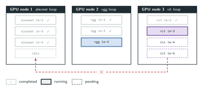

# Tokimeki for Python

Tokimeki for Python lets you submit experiments directly from a Python script and collect their return values. If you have several GPU nodes running [Tokimeki runners](https://github.com/hungngocphat01/tokimeki-cli), you can submit a function with different configurations, wait for the experiments to finish, and process the results within the same script. This is extremely useful, especially when you have to run multiple large experiment grids (for hyperparameter tuning, for example).

The package does two things. First, it is a thin wrapper around the job-accounting commands of the `tokimeki` CLI: submitting a job, inspecting and waiting for a group, and fetching a job's result each run one `tokimeki` command and parse its output, so the package never reads or writes Tokimeki's files itself. Second, it provides the Python runtime (`python -m tokimeki.call`) that runners use to launch Python jobs, which is why the project your jobs run in has to depend on it. See [How this works](#how-this-works) for both.

If you haven't set up your runners and a shared `TOKIMEKI_HOME` directory yet, see the [CLI README](https://github.com/hungngocphat01/tokimeki-cli) first.

## Installation

You'll need Python 3.9+, [uv](https://docs.astral.sh/uv/), and the `tokimeki` binary available on `PATH` (alternatively, set `TOKIMEKI_BIN`). Make sure the Python package and the CLI are on matching versions.

In your uv project:

```bash
cd /shared/projects/model_trainer
uv add "tokimeki @ git+ssh://git@github.com/hungngocphat01/tokimeki-py@v0.5.0"
uv sync
```

The project and its synced Python environment must be accessible from every runner that may execute your jobs.

## Running a hyperparameter sweep

Suppose we want to train AlexNet with three different learning rates. If we only have one GPU node, we can simply write a shell script:

```bash
#!/bin/bash
cd /shared/projects/model_trainer
for lr in 0.01 0.001 0.0001; do
    python train.py --backbone alexnet --lr "$lr"
done

# combine results after all experiment finishes
find ./results -iname "alexnet-*.csv" -exec cat {} \; | tee combined-results.csv
```

The three experiments run sequentially.

Now suppose we have several GPU nodes. One way to distribute the experiments is to write a separate script for each learning rate (`train_alexnet_lr_0.01.sh`, `train_alexnet_lr_0.001.sh`, etc.), submit them individually, and collect the results afterwards.

This is manageable when we're only experimenting with AlexNet. But what if we also want to experiment with VGG and ViT, each with its own set of hyperparameters? We would end up maintaining quite a few scripts and result files.

We could instead write one script per backbone, each containing a loop like the one above. The problem is that the GPU nodes won't necessarily finish at the same time. The node running AlexNet might have already finished all its experiments, while the node running ViT still has several configurations left to train. Those remaining experiments could have been run on the now-idle node.



Before Tokimeki v0.5.0, we generally ran sweeps using one script per backbone, training each configuration sequentially. We often found ourselves in the situation illustrated above, where some nodes were idle while others still had experiments left to run. This was the motivation for introducing the coordinator–executor model in v0.5.0.

### Coordinators

A coordinator is a job whose purpose is to submit other jobs, wait for them to finish, and collect their results. Think of it like a distributed for-loop (see an actual example in the following section).

Rather than writing a shell script that loops over the learning rates and trains each model itself, we can write a Python script that submits each training **function call** as a separate job. All these jobs go into the same shared queue, and any runner with a free executor can pick them up. The return values of the function calls are also accessible from the coordinator, so we no longer need to manage separate result files for each experiment.


The two colours represent the experiments of the two coordinators. Both coordinators submit their experiments through the shared filesystem, and all six executors are available to run them.

Unlike the original shell scripts, AlexNet experiments are no longer tied to one particular node, nor are VGG experiments. Whenever an executor becomes available, it can pick up another experiment from the queue.

**A coordinator doesn't necessarily have to run on a GPU node.** Since it only submits jobs and waits for their results, you can also run the Python script directly on your client (e.g., the login node). You'll need to keep the process alive until the experiments finish, for example by running it inside `tmux`. You also won't have the benefits of submitting the coordinator as a Tokimeki job, such as automatic retries and the ability to stop the entire group by killing or cancelling the coordinator.

Since the overhead of such script is minimal, in this guide, for simplicity, we expect you to submit the coordinator script as a job to the Tokimeki runners also.

### Groups

A group is simply a name shared by a set of related jobs. Groups allow us to track those jobs and wait for them collectively, regardless of which runners execute them. A coordinator and the jobs it submits share the same group name. For our hyperparameter sweep, we'll use a separate group for each backbone; in the illustration above, each colour is one group.

### Example: sweeping the learning rate for AlexNet

First, define what an individual experiment should do. Put the training function in an importable Python module, such as `model_trainer/jobs.py`. Here, we assume that the project already has a `train_model` function that trains a model and returns a score.

```python
from model_trainer.training import train_model


def train_trial(config):
    score = train_model(config["backbone"], config["lr"])
    return {"lr": config["lr"], "score": score}
```

Next, write the *coordinator script* as `scripts/sweep_alexnet.py`:

```python
import json
from pathlib import Path

import tokimeki as tk
from model_trainer.jobs import train_trial

group = tk.current_group()
jobs = [
    group.submit(train_trial, {"backbone": "alexnet", "lr": lr})
    for lr in (0.01, 0.001, 0.0001)
]

group.wait()    # this blocks until all jobs finishes
results = [group.result(job) for job in jobs]
Path("results").mkdir(exist_ok=True)
Path("results/alexnet-summary.json").write_text(json.dumps(results, indent=2))
```

Each call to `group.submit()` creates a separate job that runs `train_trial` with the given configuration. These jobs automatically belong to the same group as the coordinator. Once we've submitted all three jobs, `group.wait()` blocks until there are no more queued or running jobs in the group. We can then retrieve the return value of each function with `group.result()` and save the results together in a single JSON file.

Since the Tokimeki CLI takes scripts when submitting jobs, we'll wrap the Python script in `sweep_alexnet.sh`:

```bash
#!/bin/bash
set -e
cd /shared/projects/model_trainer
uv run --no-sync python scripts/sweep_alexnet.py
```

We can do the same for VGG by creating `sweep_vgg.sh` and `scripts/sweep_vgg.py`, replacing the backbone with `"vgg"` and adjusting the configurations as needed. From the login node, submit both coordinators:

```bash
tokimeki submit -C -g alexnet-lr-01 sweep_alexnet.sh
tokimeki submit -C -g vgg-lr-01 sweep_vgg.sh
tokimeki group alexnet-lr-01      # Check the progress of the AlexNet sweep
```

The `-C` flag tells Tokimeki that this is a coordinator job rather than a regular compute job. The `-g` flag specifies the group name, which we access through `tk.current_group()` in the Python script.

Note that a group includes all jobs with the same name until they are removed by `tokimeki gc`. It is therefore a good idea to use a new group name each time you run a sweep.

Killing or cancelling a coordinator also stops the other jobs in its group.

Because each coordinator has its own group, `sweep_alexnet.py` only needs to wait for and collect the results of the AlexNet experiments, even though they run mixed with the VGG ones. The VGG coordinator does the same for its own group.

Adding a ViT sweep would follow exactly the same pattern: write another coordinator and submit it with a separate group name.

## How this works

Both halves of the package take part in every Python job: the CLI wrapper runs in the coordinator, and the runtime runs on the runner that executes the job.

`group.submit()` does not run anything itself, and it does not talk to any runner. It calls the `tokimeki` CLI (`tokimeki submit`), and it is the CLI that writes the job into a file on the shared filesystem (1): the name of the function (here `model_trainer.jobs:train_trial`) and its argument. Every method in this package works the same way, as one CLI call; `group.wait()` runs `tokimeki group --wait` and `group.result()` runs `tokimeki result`.

On a GPU node, the runner is the same `tokimeki` binary, started as `tokimeki runner`. When one of its executors is free, it takes the job (2) and, because it is a Python job, runs this package's runtime in your project's environment (3):

```bash
uv run --project /shared/projects/model_trainer --no-sync python -m tokimeki.call model_trainer.jobs:train_trial
```

`tokimeki.call` is Tokimeki's Python runtime. Its job is to call Python functions natively on behalf of the coordinator: the coordinator only names `train_trial` and gives it an argument, and `tokimeki.call` is what actually imports that function on the runner's node and calls it, in an ordinary Python process inside your project's environment. It fetches the argument through the CLI (`tokimeki job`), imports `train_trial`, and calls it with that argument (4).

The runtime then hands the return value, or the exception if the function raised, to `tokimeki report`, which writes it next to the job (5). Back in the coordinator, `group.result()` gets that value from the CLI as well, through `tokimeki result` (6); the package itself never opens the file. The coordinator and the runner never talk to each other directly; everything between them is a file that one side's CLI writes and the other side's CLI reads.


Because the function runs on another node, it has to be a top-level function that the runner can import from your project, and its argument and return value have to be JSON-serializable. The runner uses the project's existing environment without syncing it (`--no-sync`, so many jobs starting at once do not fight over it), so run `uv sync` before you submit.

This section only covers what the package adds on top of Tokimeki. For how Tokimeki itself works underneath, including the queue, runners and their executors, and how every exchange between nodes goes through files, read the [CLI README](https://github.com/hungngocphat01/tokimeki-cli#architecture).

## What happens if a runner goes offline?

Jobs that are still waiting in the queue can be picked up by other runners as usual. However, a job that was already running on the lost runner stops and cannot resume on another node from where it left off.

The job will appear as **stopped** until a runner with the same ID starts again. At that point, Tokimeki marks the job as **crashed** and queues another attempt if retries were requested.

Other runners continue executing their jobs independently, even if the runner that went offline was hosting a coordinator.

Keep in mind that `group.wait()` may return while some jobs are in the stopped state. Calling `group.result(job)` on one of these jobs will raise an exception, so the coordinator in our example won't silently write an incomplete summary.

You can inspect interrupted jobs through `group.report().stopped`.

If the coordinator itself is retried, you may also want to check `group.jobs()` before submitting new jobs. Otherwise, the coordinator could submit experiments that it had already submitted during its previous attempt.

## Python API reference

| Python | Description |
|---|---|
| `tk.current_group()` | Get the group of the running coordinator. |
| `tk.Group(name)` | Access a group by name. |
| `group.submit(fn, arg)` | Submit an importable Python function with a single argument as a job. |
| `group.wait()` | Wait until there are no queued or running jobs in the group. |
| `group.result(job)` | Retrieve the return value of a completed job. |
| `group.jobs()` / `group.report()` | Inspect the jobs in a group and their statuses. |

Both the argument passed to the function and its return value must be JSON-serializable. The argument must not exceed 64 KiB.

For larger outputs, such as model checkpoints, write them to files in your project directory instead of returning them directly.

The [usage guide](docs/USAGE.md) covers every option and the other use cases: chaining jobs, running the coordinator on the login node, handling failed and stopped jobs, and restarting a coordinator without duplicates. See `help(tk.Group.submit)` for the available scheduling options and the [CLI usage guide](https://github.com/hungngocphat01/tokimeki-cli/blob/main/docs/USAGE.md) for more information on managing jobs.