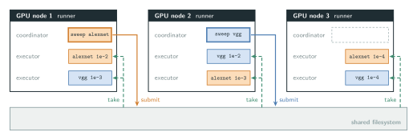
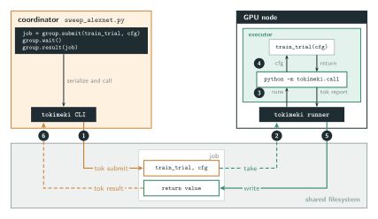

# Tokimeki for Python

Tokimeki for Python lets you distribute Python function calls across multiple compute nodes using the [Tokimeki Scheduler](https://github.com/hungngocphat01/tokimeki-cli).

It is particularly useful for running machine learning experiments, such as hyperparameter searches, where the same training function needs to be executed with different configurations. Instead of writing and managing separate shell scripts for each experiment, you can submit Python functions as jobs and collect their return values directly.

The package also provides the Python runtime that executes these functions on Tokimeki runners.

## How it works

Tokimeki for Python uses the new job orchestration daemons introduced in Tokimeki v0.5.0, which separates **job coordination** from **computation**.

- **Coordinator:** A Python script that decides which jobs to run, submits them, waits for their completion, and processes their results.
- **Compute jobs:** Individual function calls submitted by the coordinator. These execute on available Tokimeki runners.
- **Job group:** A collection of jobs managed under the same group name. The coordinator uses this group to submit jobs and retrieve their results.

For example, suppose you want to train multiple models with different hyperparameters. You write a training function that accepts a configuration and returns a score. The coordinator then submits that function once for each configuration.

Each submission becomes an independent compute job. Available runners pick up these jobs from the shared queue, allowing multiple experiments to run concurrently across different nodes.

Meanwhile, the coordinator can wait for all experiments to finish, collect their scores, and decide what to do next. It could, for instance, select the best configuration, submit a final training job, and then run ablation experiments.

**The coordinator does not perform the computation itself.** Each runner has separate coordinator and compute slots, so a coordinator waiting for its jobs does not occupy a compute slot.



## How a Python job runs

When the coordinator calls `group.submit()`, this package serializes the function's name and its argument and calls the Tokimeki CLI. A runner takes the job from the shared filesystem, runs the function in the project's Python environment with Tokimeki's Python runtime, which this package also happens to provide. The coordinator reads that value through the CLI with `group.result()`.

For this to work, the arguments and return value of your submitted function must be serializable.



## Quick example

Suppose we want to compare AlexNet and VGG using several learning rates.

We will define a function for training a single model, then write a coordinator that submits six experiments and collects their validation scores.

### 1. Define the training script

First, write the script that each *compute job* will execute.

```python
from model_trainer.training import train_model

def train_trial(config):
    score = train_model(config["backbone"], config["lr"])
    return {"backbone": config["backbone"], "lr": config["lr"], "score": score}
```

It trains one model using the specified backbone and learning rate, then returns its validation score.

### 2. Write the coordinator

Next, create a script that generates the configurations, submits the jobs, and collects their results.

```python
# sweep.py
import tokimeki as tk
from model_trainer.jobs import train_trial

# what's `group` and what does this returns? see the next section
group = tk.current_group()
configs = [
    {"backbone": backbone, "lr": lr}
    for backbone, rates in {
        "alexnet": (0.01, 0.001, 0.0001),
        "vgg": (0.02, 0.0025, 0.0003),
    }.items()
    for lr in rates
]

jobs = [
    group.submit(train_trial, config, desc=f'{config["backbone"]} lr={config["lr"]}')
    for config in configs
]
group.wait() # this blocks until all jobs finish

# collect results
results = [group.result(job) for job in jobs]
df = run_analysis(results)
df.to_parquet("...")
```

The important parts are:

1. `tk.current_group()` obtains the job group associated with the running coordinator.
2. `group.submit()` submits a Python function call as an independent compute job.
3. `group.wait()` waits for the group's active jobs to finish.
4. `group.result(job)` retrieves the Python value returned by a completed job.

In this example, six compute jobs are submitted. They can execute concurrently on any available runners, regardless of which node is running the coordinator.

The coordinator only manages these jobs and collects their results; the actual training happens on the compute nodes.

### 3. Run the coordinator

To run the coordinator through Tokimeki, create a shell script that wraps it.

```bash
#!/bin/bash
set -e
cd /shared/projects/model_trainer
uv run --no-sync python sweep.py
```

Save it as `sweep.sh`, then submit it using the Tokimeki CLI:

```bash
tokimeki submit -C -g models-001 sweep.sh
```

Here:

- `-C` runs the script as a **coordinator**, rather than a regular compute job.
- `-g models-001` assigns it to the `models-001` job group.

Inside the coordinator, `tk.current_group()` automatically opens this group. All compute jobs submitted through it belong to the same group.

Use a different group name for each experiment sweep. Groups retain their jobs until they are cleaned up with `tokimeki gc`.

Once submitted, Tokimeki manages the coordinator and its compute jobs. The coordinator submits six training jobs, waits for their completion, and prints the collected results.

## Setup

### Requirements

- Python 3.9+
- [uv](https://docs.astral.sh/uv/)
- The `tokimeki` CLI available on `PATH`, or configured through `TOKIMEKI_BIN`
- Configured [Tokimeki runners](https://github.com/hungngocphat01/tokimeki-cli#-setup) with a shared `TOKIMEKI_HOME`

### Installation

Install the package in the uv project that contains your training code:

```bash
cd /shared/projects/model_trainer
uv add "tokimeki @ git+ssh://git@github.com/hungngocphat01/tokimeki-py@v0.5.0"
uv sync
```

The project directory and its synced Python environment must be accessible from every runner that may execute a compute job.

When a job starts, the runner uses the existing environment without installing or synchronizing packages.

## Running without a coordinator job

A coordinator does not necessarily have to run as a Tokimeki job.

You can also execute the Python script directly, for example on a login node or your local machine, provided it has access to the shared Tokimeki environment.

In this case, replace:

```python
group = tk.current_group()
```

with:

```python
group = tk.Group("models-001")
```

Then run:

```bash
uv run python scripts/sweep.py
```

The script still submits compute jobs to Tokimeki runners and retrieves their results. The difference is where the coordinator itself runs.

When running directly, you are responsible for keeping the process alive until it finishes, for example using `tmux`.

By contrast, submitting the script with `tokimeki submit -C` allows Tokimeki to manage its lifecycle. Killing or canceling the coordinator also stops its group.

## Python API

| Python | Purpose |
|---|---|
| `tk.Group(name)` | Open a job group by name, including outside a Tokimeki job. |
| `tk.current_group()` | Open the group associated with the running coordinator. |
| `group.submit(fn, arg)` | Submit a Python function call as a compute job. |
| `group.wait()` | Wait until all active jobs in the group finish. |
| `group.result(job)` | Retrieve the return value of a completed job. |
| `group.jobs()` | Inspect the jobs in a group. |
| `group.report()` | Retrieve information about the group's jobs and their statuses. |

### Job function requirements

Functions submitted as compute jobs must be importable by the runners.

Both the function argument and its return value must be JSON-serializable. Function arguments are limited to 64 KiB.

For large outputs, such as trained model checkpoints, save them to files in a shared directory and return their paths instead.

## Further documentation

- [Python usage guide](docs/USAGE.md) — Scheduling options, job failures, retries, and Python job execution.
- [Tokimeki CLI](https://github.com/hungngocphat01/tokimeki-cli) — Runner setup, job management, and CLI commands.
